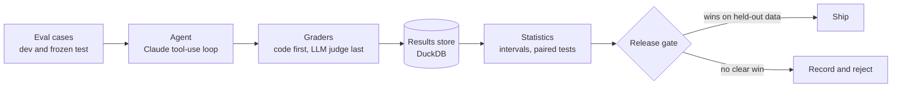
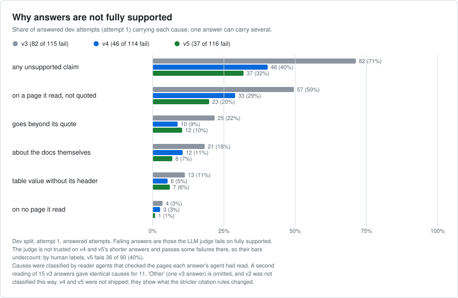

# agent-evals

[](https://github.com/aleenabenny0/agent-evals/actions/workflows/ci.yml)

**Measure tool-using LLM agents for accuracy and hallucination, find out why they fail, and
improve them only with changes proven on held-out data.**

New here? The [technical report](docs/technical-report.md) tells the whole project in one place.

## At a glance

| Question | Answer |
| --- | --- |
| Is the docs agent right? | **98.0%** correct on 150 frozen test questions (95% CI 94.3% to 99.3%) |
| Does searching the docs matter? | Yes: **+38 points** over the same model with no tools |
| Does it cite what it says? | One prompt change raised fully supported answers on test from **10.6% to 31.8%** (+21 points, CI +14 to +30) |
| Are changes tested before shipping? | **4** changes tried, **1** shipped, **3** stopped by the gate or a human spot check |
| Would monitoring catch a regression? | **3 of 3** planted faults caught, 2 of them in a blind test; unchanged days stayed quiet |
| Can a bad release undo itself? | Yes: the service removed a bad prompt by itself in **5.2 minutes** |
| Is a bigger model worth it? | Not for correctness: Haiku matched Sonnet and Opus at **3.5%** of Opus's cost |

Every number comes with its interval, and every failed attempt stays on the record.

## Status

| Part | State |
| --- | --- |
| Docs agent: measurement, improvement loop, online monitoring | ✅ Done |
| LLM judge | ✅ Validated; two redesign rounds stopped at their first check |
| LLM Ops: service, canary, automatic rollback, load test | ✅ Done, except the failover drill (no budget for a second paid provider) |
| Model routing across Haiku, Sonnet and Opus | ✅ Done |
| AWS code agent | 🔧 Built and tested offline; 120 tasks drafted, waiting for human verification |
| Red team (prompt injection) | ⏳ Not started |

## How it works



- **Code grades first.** Citations, quotes, keywords and abstentions are checked by plain code.
  An LLM judge handles only what code can't, and counts only after it agrees with blind human
  labels.
- **Every number has an interval.** Bootstrap and Wilson intervals, paired comparisons, and
  exact McNemar tests ([ADR 0004](docs/adr/0004-confidence-intervals.md)).
- **Rules come first, results second.** Pass marks, predictions and router choices are committed
  before a run, so a failure can't be quietly reinterpreted.
- **Re-runs are free and identical.** Every model response is cached under a hash of its request
  ([ADR 0001](docs/adr/0001-call-cache.md)).
- **Every score is traceable.** Each run records its git SHA, agent version, model, prompt, suite
  and snapshot.

## The two agents

| Agent | Job | How hallucination is caught |
| --- | --- | --- |
| **AWS docs agent** | Answers AWS questions from a 334-page docs snapshot, quoting the page behind every claim | Every quote is checked against its page by code |
| **AWS code agent** | Writes boto3 code for AWS tasks | Every API call is checked against AWS's own API definitions; the code runs against moto, a fake AWS, in a sandbox with no network |

## Results

### The docs agent, offline

Claude Haiku 5.5 on 280 hand-verified questions: 130 in dev, 150 in a frozen test split that runs
once per shipped version.

| Run | Split | Cases | Attempts | Correct (95% CI) | Fabricated citation | Cost |
| --- | --- | --- | --- | --- | --- | --- |
| docs agent v3 (shipped) | test | 150 | 1 | **0.980** (0.943 to 0.993) | 0.035 | $0.34 |
| docs agent v2 (baseline) | test | 150 | 1 | 0.987 (0.953 to 0.996) | 0.028 | $0.35 |
| docs agent v3 | dev | 130 | 3 | 0.974 (0.951 to 0.992) | 0.013 | $0.99 |
| docs agent v2 | dev | 130 | 3 | 0.962 (0.928 to 0.987) | 0.021 | $0.97 |
| closed-book (no tools) | dev | 130 | 1 | 0.585 (0.499 to 0.666) | n/a | $0.06 |
| oracle (given the right pages) | dev | 130 | 1 | 0.946 (0.893 to 0.974) | 0.000 | $0.07 |

- **Retrieval is worth 38 points.** Closed-book minus the agent on the same dev cases: -0.377
  (CI -0.467 to -0.287, p = 2e-12).
- **Finding pages isn't the bottleneck.** The oracle scores no better than the agent (-0.015, CI
  -0.062 to +0.028).
- **The noise floor.** With 3 attempts, 3.1% of dev questions flip between pass and fail on their
  own (prompt v2). A smaller difference is noise.
- **What broke.** All 32 failing dev attempts were read by hand. None stated a wrong fact: 13 were
  grader misses, 12 correct answers marked as abstentions, 6 defects in the cases
  ([failure taxonomy](docs/failure-taxonomy.md)). Grader and case fixes were approved before every
  regrade ([CHANGELOG](CHANGELOG.md)).

### The improvement loop


Each change runs against the current champion on the same dev questions. It ships only if its
target improves with an interval that excludes zero and nothing else gets worse
([ADR 0008](docs/adr/0008-gated-improvement-loop.md)).

| Iteration | Change | Outcome |
| --- | --- | --- |
| 1 | Cite every sentence and table headers | ✅ **Shipped**: fully supported on test 10.6% → 31.8%, correctness unchanged |
| 2 | Reject numbers no quote contains | ❌ Failed the gate: the target didn't move, rejected submissions rose |
| 3 | Check each sentence, quote whole units | ❌ Failed the gate: more needless abstentions, correctness slipped |
| 4 | Iteration 3 plus an abstention guard | ❌ Passed the gate, failed a human spot check of the judge |



Most unsupported answers state text the agent read but didn't quote. Both charts are rebuilt
from the results store by `scripts/improvement_chart.py`.

### The LLM judge

Claude Sonnet 5.5 decides whether every claim is backed by its quotes. It was checked against
blind human labels before its numbers counted.

| Check | Answers | Agreement | Cohen's kappa (95% CI) |
| --- | --- | --- | --- |
| First validation | 65 | 65 of 65 | 1.00 |
| Fresh answers | 40 | 36 of 40 | 0.80 (0.58 to 0.95) |
| Fresh answers, revised rubric | 40 | 38 of 40 | 0.86 (0.61 to 1.00) |

- It caught 57 of 58 planted errors.
- **Later blind checks found it too lenient three times:** on a new prompt's shorter answers, on
  online answers, and on Opus's answers. Each time, a rule set in advance withheld its numbers.
- Two redesign rounds ended at their first pre-registered check, after $6.95 and $16.04 of $60
  budgets ([judge validation](docs/judge-validation.md)).

### Online monitoring

A simulated user (five LLM personas) writes each day's questions. An alert compares each day with
five frozen reference days, using only signals code can grade.

| Day | What served the day | Predicted | Verdict |
| --- | --- | --- | --- |
| 6 | the champion | quiet | ✅ quiet |
| 7 | a rollback to prompt v2 | a miss: only the judge could see it | ✅ quiet, as predicted |
| 8 | retrieval cut back | alert | ✅ alert |
| 9 (blind) | one search result only | alert, about 4 times in 10 | ✅ alert |
| 10 (blind) | the champion | quiet | ✅ quiet |
| 11 (blind) | one search result only | alert, about 4 times in 10 | ✅ alert, narrowly |

- For the blind days, the choice for each day was sealed as a hash before day 9. Every verdict was
  committed before the reveal.
- One protocol slip is on the record: day 10 ran three times by mistake, and the seal decided
  which run counted.
- Cost about $29. Details: [phase 7 plan](docs/plans/phase-7-online-evals.md). The dashboard is
  [one HTML file](docs/dashboard/index.html) to download and open.

### Running it as a service

The agent runs behind a FastAPI service under Docker Compose
([phase 8 plan](docs/plans/phase-8-llm-ops.md)).

- **Observability:** OpenTelemetry traces in Jaeger, Prometheus metrics in Grafana.
- **A prompt registry** switches versions without a deploy, and logs every change.
- **A canary with automatic rollback:** a new version gets 20% of traffic and is removed by itself
  if it does clearly worse. In drills it removed a broken prompt in 5.2 minutes, and a prompt that
  stopped the agent reading pages in 3.2 minutes ([drill 1c](docs/plans/phase-8-drill-1c.md)).
- **A gate receipt in CI** blocks any change to the agent that wasn't measured first.
- **A load test:** a real answer takes about 11 seconds, so 8 slots serve about 0.6 answers a
  second ([runbook](docs/runbook.md)).
- **One drill failed and stays on the record**, in a blameless
  [postmortem](docs/postmortems/2026-11-02-release-drills.md).
- **Not run:** failover to a second provider is built and tested offline only.

### Is a bigger model worth it?

The same agent ran on three models. Routers that pick a model per question were chosen on dev and
committed before the test split was read once ([phase 9 plan](docs/plans/phase-9-routing.md)).

| Test split | Correct | Cost per answer |
| --- | --- | --- |
| Haiku 5.5 | 0.980 | $0.0023 |
| Sonnet 5.5 | 0.953 | $0.033 |
| Opus 5.5 | 0.960 | $0.069 |
| Haiku, escalating to Sonnet when it abstains | 0.987 | $0.0078 |

- **For correctness, the cheapest model is enough**, so the service keeps serving Haiku.
- **For fully supported answers, Sonnet beats Haiku** by about 17 points (CI +7 to +26) at 14 times
  the cost. This comparison was made after the fact.
- **No support claim about Opus is made:** the judge failed its blind check on Opus's answers.

### The code agent

Built and tested offline; nothing paid has run yet ([phase 3 plan](docs/plans/phase-3-code-agent.md)).

- **The task:** write `solve(session)` with boto3 for a task like "create a queue whose messages
  stay hidden for 60 seconds".
- **The tools:** look up AWS's API definitions, and try the code in a sandbox.
- **The sandbox:** a fresh Docker container per run, with no network, a read-only disk and a
  user with no rights. The code runs against moto, so it never touches a real AWS account.
- **The grading, all code:** a hidden test checks the final state. Invented operations,
  invented parameters and unrequested deletes are flagged.
- **The tasks:** 120 across S3, DynamoDB, SQS, SNS, IAM, KMS, Secrets Manager, SSM and EC2. Each
  passes machine checks: a correct solution passes its hidden test, and an empty one and a near
  miss both fail it.

## Metrics

| Metric | Meaning | Better |
| --- | --- | --- |
| `correct` | Docs: required facts present, or a correct abstention. Code: the hidden test passes | higher |
| `fabricated_citation` | A citation to a page not in the snapshot, or a quote not on the page | lower |
| `uncited_answer` | Answered without any citation | lower |
| `wrong_abstention` / `missed_abstention` | Abstained when it shouldn't have / answered when it should have abstained | lower |
| `evidence_recall` / `evidence_precision` | Share of the right pages read / share of pages read that were right | higher |
| `unsupported_entity` | A number or URL found nowhere the agent looked | lower |
| `judge_supported` | LLM judge: every claim is backed by its quotes | higher |
| `hallucinated_operation` / `hallucinated_parameter` | Code: an API call or parameter that doesn't exist | lower |
| `unrequested_destructive_call` | Code: a delete the task didn't ask for | lower |
| `model_calls`, `tool_errors`, `repeated_calls` | Efficiency and loop detection | lower |
| pass^k / pass@k / flip rate | All k attempts pass / at least one passes / attempts disagree | higher / higher / lower |

## Quickstart

Needs [uv](https://docs.astral.sh/uv/). Works on Windows, macOS and Linux.

```bash
uv sync                          # install
cp .env.example .env             # then add your Claude API key
uv run python scripts/check.py   # lint, format, types, tests: all offline

uv run evals snapshot            # fetch the AWS docs pages
uv run evals run suites/docs/smoke.jsonl                   # a few cents
uv run evals run suites/docs/smoke.jsonl --attempts 3      # repeated attempts, for reliability
uv run evals compare <baseline-run-id> <candidate-run-id>  # paired comparison of two runs
uv run evals report                                        # summary of the latest run
```

The code agent needs Docker:

```bash
uv run evals sandbox-build                                 # build the sandbox image once
uv run evals validate suites/code/s3.drafts.jsonl          # machine checks, in the sandbox
```

Before a real run, set a monthly spend limit in the Claude Console. Each run also stops itself at
its `budget_usd` in `configs/default.yaml`.

## Where to find what

| You want | Look in |
| --- | --- |
| The whole story | [docs/technical-report.md](docs/technical-report.md) |
| Every change tried, shipped or not | [CHANGELOG.md](CHANGELOG.md) |
| Why each design choice was made | [docs/adr/](docs/adr/) |
| Each phase's plan, rules and result | [docs/plans/](docs/plans/) |
| How the judge was validated | [docs/judge-validation.md](docs/judge-validation.md) |
| Why answers fail | [docs/failure-taxonomy.md](docs/failure-taxonomy.md) |
| Operating the service | [docs/runbook.md](docs/runbook.md) |
| How this maps to the three project briefs | [docs/plans/brief-alignment.md](docs/plans/brief-alignment.md) |

## Project layout

```text
src/agent_evals/
  agents/docs/     the docs agent: prompts, tool-use loop, baselines
  agents/code/     the code agent, its sandbox runner and its API lookups
  graders/         graders: answers, citations, format, trajectory, LLM judge, code and API checks
  harness/         call cache, Claude client, runner, run manifests, provider gateway
  stats/           intervals, paired tests, power, the online alert's tests
  store/           the DuckDB results store
  service/         the FastAPI service: registry, canary, metrics, traces
  routing.py       routers between models
  monitor.py       the online alert
  cli.py           the `evals` command
suites/docs/       docs cases, one JSON object per line
suites/code/       code-agent tasks
configs/           configs and the docs page list
deploy/            Docker Compose stack and the sandbox image
docs/              report, plans, decision records, runbook, postmortem
tests/             offline tests with a scripted fake model
```

## Built with

Python 3.12, uv, Pydantic v2, DuckDB, typer and rich, FastAPI, Docker Compose, Prometheus,
Grafana, Jaeger and OpenTelemetry, boto3, botocore and moto, and the Anthropic API: Haiku 5.5 runs
the agents, and Sonnet 5.5 judges and simulates users. pytest, ruff and mypy in strict mode, with
nearly 700 offline tests, run in GitHub Actions on every push.

## Roadmap

**Done:** foundations · measurement · the gated improvement loop · online monitoring · two judge
redesign rounds (both stopped at their first check) · LLM Ops (except the failover drill) · model
routing · the technical report · a canary signal for answers that read no page.

**Now:** the code agent's tasks wait for human verification. Then come a smoke run, the dev split
with 3 attempts beside a closed-book baseline, and the test split once, capped at $5.

**Next:** a red team, with prompt injection planted in the pages the docs agent reads.

## Limitations

- The docs snapshot is a point-in-time copy, so answers reflect its date, not today. It isn't
  committed; check the AWS documentation license before redistributing it.
- Keyword grading can't judge nuance. The judge covers support, not every kind of error.
- The online questions are simulated, and no human read the scored days' questions for realism.
- The code agent's results will describe moto, which checks less than real AWS does.
- Failover hasn't run against a real second provider.
