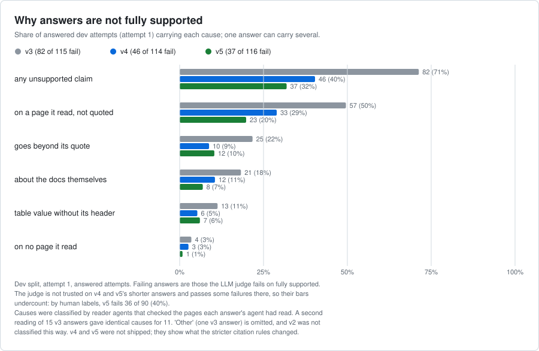

# agent-evals

**Measure tool-using LLM agents for accuracy and hallucination, find out *why* they fail, and
improve them only through changes that are proven on held-out data.**

## Highlights

- **Hallucination checked by code, not by opinion.** The AWS docs agent must quote the page
  behind every claim, and every quote is verified against that page. An LLM judge handles only
  what code cannot settle; it was validated against blind hand labels before any of its numbers
  counted, and when it later failed a blind check on online answers, it was kept out of the
  alert.
- **Improvements must win on held-out data.** One prompt change shipped through a
  champion-versus-challenger gate: fully supported answers on the frozen test split rose from
  10.6% to 31.8% (+21 points, 95% CI +14 to +30) with correctness unchanged. Three other changes
  were rejected by the gate or by a human spot check, and are recorded with their reasons.
- **Monitored like production, tested blind.** A simulated user generates days of fresh
  questions; an alert compares each day with frozen reference days. It caught all three
  deliberate retrieval faults (the last by a narrow margin), two of them in a blind test whose
  choices were sealed as a hash beforehand, and stayed quiet on the unchanged days. A fault only
  the LLM judge could see was pre-registered as a miss, and was one.
- **Every number has an interval, and every failure stays on the record.** Bootstrap intervals,
  paired comparisons, exact tests, pre-registered predictions, and the rounds that failed, all
  in the docs below. The latest, a judge redesign, stopped at its first pre-registered check
  after $6.95 of a $60 budget.
- **Engineering:** Python 3.12, mypy strict, over 400 offline tests, a DuckDB results store, a
  content-addressed call cache that makes re-runs free and identical, and CI on every push to
  main and every pull request.

The platform evaluates two agents that engineers use every day:

| Agent | Job | How hallucination is caught |
| --- | --- | --- |
| **AWS docs agent** *(built)* | Answers AWS questions using a dated docs snapshot, citing each claim with a verbatim quote | Every quote is checked against the cited page; invented pages and misquotes are flagged by code, not by an LLM |
| **AWS code agent** *(planned)* | Writes boto3 code for AWS tasks | Every API call will be checked against botocore's service models; code will run against moto in a no-network sandbox |

> Status: **measurement, the first improvement loop and online monitoring are done for the docs
> agent.** The harness, graders, statistics, results store, an LLM judge validated against a
> human on dev answers, four gated improvement iterations (one shipped), and an online alert
> tested on simulated days, three of them blind, work end to end; the charts and tables below
> summarize them. A judge improvement round, meant to let the judge's score join the online
> alert, stopped at its first pre-registered check on 2026-10-29, so the validated judge stays
> and its score stays out of the alert. Next: LLM Ops, model routing and the code agent (see
> [Roadmap](#roadmap)).

## Why this is built the way it is

- **Agents plug in through one interface** (`Agent` protocol in `src/agent_evals/types.py`). The
  harness never imports an agent's internals.
- **Cheapest reliable grader first.** Citation checks, keyword checks and abstention checks are
  plain code. An LLM judge is added only for what code can't settle.
- **Every number has a confidence interval.** Bootstrap over cases, paired comparisons between
  runs, exact McNemar test on flipped cases, and τ-bench's pass^k for reliability.
- **Every score is traceable.** Each run stores a manifest: git SHA, agent version hash, model,
  prompt hash, suite hash, docs snapshot fingerprint and package versions.
- **Re-runs are free and identical.** A content-addressed call cache stores every model
  response. Repeated attempts at the same case are salted so they stay separate samples
  ([ADR 0001](docs/adr/0001-call-cache.md)).

## Results so far (updated 2026-10-28)

Docs agent on claude-haiku-5-5 over a 334-page AWS documentation snapshot. In the offline
results every number has its 95% interval and n; the test split is frozen and was run once per
shipped version. The online results (phase 7) are below them.




The first chart is the improvement loop. One change shipped (v3, cite every sentence): it lifted
the holdout's fully-supported rate from 11% to 32%, with correctness unchanged. Three later
changes were tried on dev and not kept; the chart gives each one's reason, from the gate or from
the human spot check of the judge. The second chart shows why answers fall short: mostly text
the agent had read but did not quote, which the stricter citation prompts cut by more than half,
although those prompts were not shipped. Both charts are rebuilt from the results store by
`scripts/improvement_chart.py`, and every plotted number is in `docs/charts/improvement.json`.

| Run | Split | Cases | Attempts | correct (95% CI) | fabricated_citation | Cost |
| --- | --- | --- | --- | --- | --- | --- |
| docs agent v3 (after iteration 1) | test | 150 | 1 | **0.980** (0.943 to 0.993) | 0.035 | $0.34 |
| docs agent v2 (baseline) | test | 150 | 1 | 0.987 (0.953 to 0.996) | 0.028 | $0.35 |
| docs agent v3 | dev | 130 | 3 | 0.969 (0.944 to 0.990) | 0.013 | $0.99 |
| docs agent v2 | dev | 130 | 3 | 0.956 (0.921 to 0.985) | 0.021 | $0.97 |
| closed-book baseline (no tools) | dev | 130 | 1 | 0.585 (0.499 to 0.666) | n/a | $0.06 |
| oracle baseline (gold pages given) | dev | 130 | 1 | 0.938 (0.883 to 0.968) | 0.000 | $0.07 |

Rates in this table are per run. The CHANGELOG pairs the cases two runs share, so a figure can
differ slightly: v3's test fabricated_citation is 0.035 over its 143 cited cases and 0.028 over
the 142 it shares with v2.

- Retrieval is worth 37 points: closed-book minus the docs agent (v2) on the same dev cases is
  -0.372 (95% CI -0.462 to -0.282, McNemar p = 3e-12).
- Retrieval is not the bottleneck: the oracle, handed the right pages, scores 0.018 below the
  docs agent (95% CI -0.064 to +0.028, no detectable change).
- Reliability on dev with 3 attempts (v2): pass^3 0.938, pass@3 0.977, **flip rate 0.038**
  (0.017 to 0.087). It first read 0.100; most of that was the keyword grader (next point). A
  change between two prompt versions smaller than that band is noise.
- Dev is the harder split by design (it holds the paraphrase groups and the held cases), which is
  why its score is below test's. Dev correctness was regraded after iteration 1 widened the keyword
  lists of 20 dev cases, and again on 2026-10-17 after 10 more, both approved before the regrade
  (gold answers unchanged; test cases untouched). The second regrade covered all six dev runs,
  including the two baselines the first had skipped, so every dev number above rests on the same
  keyword lists.
- LLM judge (Sonnet 5.5, run after the fact on the stored answers), **validated against 65 hand
  labels made blind**: on "fully supported" (every claim in the answer is in the quotes it cites)
  the judge and the human labeler agree on all 65, kappa 1.00, on 36 of 40 fresh answers in a second
  check (kappa 0.80, 95% CI 0.58 to 0.95), and on 38 of 40 more in a third, labeled under the
  revised rubric (kappa 0.86, 0.61 to 1.00). That is this project's claim-level hallucination rate.
  **Iteration 1** (one prompt change: quote every sentence, cite table headers) moved it on the
  frozen test split from **10.6% to 31.8%** of answers fully supported (+21 points, 95% CI +14 to
  +30, p = 8e-7) with correctness unchanged (0.987 to 0.980, interval spans zero). The gate, the dev
  numbers, the one cost (run-to-run consistency dipped from 97% to 93%) and the grader fix it
  exposed are in [CHANGELOG.md](CHANGELOG.md) and ADR 0008. Iterations 2 and 3 were rejected by the
  gate and are recorded there too. Iteration 3's prompt doubled the judge's dev fully-supported rate
  (0.31 to 0.60), but its answers were 27% shorter, so under its pre-registered check that number is
  not trusted without a 30-answer human spot check, which never ran; it also abstained on more
  answerable questions and correctness slipped, so v3 stays. Iteration 4 (v4 plus an abstention
  guard) passed the dev gate, but a pre-registered human spot check found the judge too lenient on
  its shorter answers. Two attempts to repair the judge (one rubric paragraph, tested and then
  retested) each narrowly missed their rule, so it is not shipped. By the labeler's own 90 labels
  its answers are fully supported 60% of the time, against 34% for v3, on different samples (a
  random 90 for v5, the first 80 in case-id order for v3), so not a paired comparison. "Core
  supported" (just the claims that answer the question; 89.3% pass) is reported as advisory: kappa
  0.37 on the 65, 0.79 on the 40 fresh answers but with only 3 failures among them, so the interval
  spans 0 to 1. Two candidate judges with revised rubrics were each tested on 40 fresh labels under
  a rule fixed in advance, and neither replaced it: the second tied on the labels and missed one
  planted error, on a mutant later found to plant none. "Responsive" (0.997 pass) is validated on 61
  closed-book answers at kappa 0.68 to 0.84. Planted-error mutants were caught 57 of 58 times on the
  first dev run (qualifier mutants 4 of 5) and 55 of 56 on the current champion's run (the miss
  planted no error); verdict stability under re-sampling is 84% and 95% on those runs. Everything,
  including the rounds that failed: [docs/judge-validation.md](docs/judge-validation.md).
- What broke: all 32 failing dev attempts were read. None states a wrong fact. 13 are keyword grader
  misses, 12 are the agent answering correctly while marking itself abstained, 6 are case defects.
  Details and two traces per category in [docs/failure-taxonomy.md](docs/failure-taxonomy.md).

### Online: a simulated user, an alert, and a blind test (phase 7, done 2026-10-23)

The docs agent was then watched as it would be in production, on simulated traffic. Five LLM
personas (claude-sonnet-5-5) write each day's questions from snapshot pages, with no answer key,
and a checker call confirms that each lookup or comparison is answerable from one section of
its page. The author reviewed 30 sampled questions of the first generator and found all of them
realistic; the revised
generator that wrote days 1 to 11 passed automated answerability and copying checks, but no
human read its questions for realism. With no answer key, only checks that need none score the
answers:
citation checks, uncited answers, declined in-scope questions, errors, model calls, latency and
tokens. The LLM judge's "fully supported" verdict is recorded and drawn too, but never alerts.

`evals monitor DAY` compares a day with five frozen reference days (100 questions each, 500
attempts). The six code-graded metrics are tested as one family (Holm at 0.05, a correction for
testing several metrics at once), and each must rise past a floor to alert (5 points, 2 points for
errors, 0.5 model calls, +25% for latency and tokens); fabricated citations have their own rule (p <
0.01, no floor). A floor is the smallest rise that may alert, not what is reliably caught: on a
200-question day a rise is caught 8 times in 10 only from about +3.9 points of errors, +0.61 model
calls, +28% latency, +30% tokens, +7 points of uncited answers or declines, and +6.5 points of
fabricated citations (from 2.8% to about 9%). On days 7 to 11 (200 questions each, 165 to 174 of
them answered) the champion (the current best configuration) also answers the same questions as a
shadow, so a paired difference tells a changed config from unusual traffic. The dashboard
([docs/dashboard/index.html](docs/dashboard/index.html), one HTML file: download it and open it in a
browser) draws every day against a normal day's range.

| Day | What served the day | Pre-registered | Monitor's verdict, against the reference days | Served minus shadow on the same questions, model calls per attempt (95% CI) |
| --- | --- | --- | --- | --- |
| 6 | the champion, 100 questions | no alert | no alert | no shadow |
| 7 | a rollback to prompt v2 | no alert: an honest miss | no alert | +0.01 (-0.14 to +0.17) |
| 8 | one search result, and page reads cut from 8,000 to 2,000 characters | model calls and errors | **alert**: model calls +1.85, errors +2.9 points | +1.99 (+1.74 to +2.25) |
| 9, blind | one search result ("subtle") | model calls, about 4 times in 10 | **alert**: model calls +0.88 | +0.68 (+0.48 to +0.90) |
| 10, blind | the champion ("unchanged") | no alert | no alert | +0.00: a cache replay of the served run, not an independent check |
| 11, blind | one search result ("subtle") | model calls, about 4 times in 10 | **alert**: model calls +0.52, against a +0.50 floor | +0.72 (+0.54 to +0.92) |

- **Day 7 misses on purpose.** The rollback makes answers less fully supported, and no alerting
  metric sees that. The judge's "not fully supported" share rose from 0.747 to 0.891, while the
  shadow on the same questions stayed at 0.749. The monitor flagged that day's judge as
  untrusted, because v2's answers were 42% longer than the reference's (its rule allows 25%), so
  the reading rests on the paired shadow. The judge cannot alert at all: after day 6 and before
  day 7 it failed a blind check, in which the author's blind labels failed 4 of the 15
  reference-day answers it passed, against a bar of 2.
- **The blind days.** Before day 9, the author sealed a choice for each of days 9 to 11 (unchanged,
  subtle or larger) as a hash with a passphrase. Every verdict was committed before the reveal, and
  the reveal checked the hash and each counted run's recorded config: caught, quiet as expected,
  caught. Two gaps are on the record: day 9's shadow ran before its verdict, and day 10's run totals
  were seen before the seal picked its run. The verdicts are computed by code under rules frozen
  beforehand, so neither could change them.
- **What three blind days do not show.** They demonstrate the alert; they do not measure its
  power. The subtle fault was predicted from the dev split to alert about 4 times in 10, at the
  dev estimate of +0.47 calls (95% CI +0.27 to +0.70). Online it added +0.68 and +0.72 against
  the champion on the blind days (and +0.57 in a mistaken day-10 run); at those effects a
  200-question day alerts about 9 times in 10, so the dev estimate ran low. Day 11 cleared the
  floor by only 0.02 calls per attempt: its shadow used fewer calls than the reference (4.61
  against 4.81), so its rise against the reference was smaller than against its own shadow, as
  day 9's shadow, above the reference, had widened day 9's margin.
- **A protocol slip, kept on the record.** Day 10 ran three times by mistake, twice under the
  wrong setting. The seal, not a person, decided which run counted, and `evals blind run` now
  checks the seal before it spends anything.
- The phase cost about $29. Every pre-registration, verdict, review and correction is in
  [docs/plans/phase-7-online-evals.md](docs/plans/phase-7-online-evals.md), and the records are
  in `results/online/`.

## Metrics so far

| Metric | Meaning | Better |
| --- | --- | --- |
| `correct` | Required facts present (answerable), or abstained (unanswerable) | higher |
| `fabricated_citation` | Any citation to a page not in the snapshot, or a quote not on the page | lower |
| `citation_valid_rate` | Share of citations that check out | higher |
| `uncited_answer` | Answered without any citation | lower |
| `wrong_abstention` / `missed_abstention` | Abstained when it shouldn't have / answered when it should have abstained | lower |
| `evidence_recall` | Share of gold pages the agent actually read or cited | higher |
| `evidence_precision` | Share of the pages the agent read that were gold pages (omitted when it read nothing) | higher |
| `unsupported_entity` | Answer states a number or URL found in neither the question nor any page the agent read or cited | lower |
| `repeated_calls` | Identical tool calls (same tool, same input) within one trajectory: loop detection | lower |
| `model_calls`, `tool_errors`, `rejected_submissions` | Efficiency and recovery signals from the trajectory | lower |
| `judge_supported` | LLM judge: every claim in the answer is backed by its cited quotes (claim-level hallucination, inverted). Validated on 65 blind labels of dev answers; two later blind checks found it too lenient (3 false passes in 30 labels of a challenger's shorter answers, against a bar of 2; 4 in 15 passed online answers, against 2), so online it is reported but never alerts | higher |
| `judge_core_supported` | LLM judge, advisory: the claims that answer the question are backed by the cited quotes | higher |
| `judge_responsive` | LLM judge: the answer addresses the question as asked and agrees with the gold on substance | higher |
| pass^k | Chance that all k attempts at a case pass; what a user who asks once gets | higher |
| pass@k | Chance that at least one of k attempts passes; the gap to pass^k is reliability lost | higher |
| flip rate | Share of cases whose repeated attempts disagree: the noise floor for any comparison | lower |

In the brief's words: `uncited_answer`, `wrong_abstention` and `missed_abstention` are this agent's
policy violations. A fabricated-action rate does not apply, because the agent only reads.
`unsupported_entity` is deliberately not called "fabricated": a converted figure ("15 minutes"
for a page that says "900 seconds") is flagged too, and the LLM judge settles those (ADR 0007).
The closed-book baseline scores near 100% on it by construction, which is what a baseline is for.

## Quickstart

Requires [uv](https://docs.astral.sh/uv/). Works natively on Windows, macOS and Linux.

```bash
uv sync                       # install dependencies
cp .env.example .env          # then paste your Claude API key into .env
uv run python scripts/check.py   # lint, format, types, tests, suites (offline; = make check)

uv run evals snapshot         # fetch the AWS docs pages in configs/docs_pages.txt
uv run evals snapshot --check # has the documentation drifted since the snapshot? (monthly in CI)
uv run evals validate suites/docs/smoke.jsonl   # with a snapshot: checks evidence pages and quotes too
uv run evals review suites/docs/<name>.drafts.jsonl --reviewer <you>   # verify drafts one by one
uv run evals split suites/docs/verified.jsonl --dev 130 --test 150 --seed 20261011   # done once; ADR 0006
uv run evals power --cases 150                       # how many cases detect a 10-point change
uv run evals run suites/docs/smoke.jsonl --agent closed-book   # baselines: closed-book, oracle-evidence
uv run evals run suites/docs/smoke.jsonl            # costs a few cents
uv run evals report                                  # summary of the latest run
```

Run with repeated attempts to measure reliability, then compare two runs:

```bash
uv run evals run suites/docs/smoke.jsonl --attempts 3
uv run evals compare <baseline-run-id> <candidate-run-id>
```

Before your first real run, set a monthly spend limit in the Claude Console and fill in
`pricing` in `configs/default.yaml` so the per-run budget cap can work.

## Built with

Python 3.12 and uv; Pydantic v2 for data that crosses module boundaries; DuckDB for results;
typer and rich for the CLI; the Anthropic API (claude-haiku-5-5 runs the agent, claude-sonnet-5-5
judges and simulates users); pytest, ruff and mypy --strict, run in GitHub Actions.

## Project layout

```text
src/agent_evals/
  types.py              Case, AgentResult, Step, Grade, Agent and Grader protocols
  config.py             typed YAML config
  corpus.py             documentation snapshot: BM25 search, page reads, quote checks
  tool_markup.py        detects tool-call syntax leaked into an answer
  harness/              call cache, cached Claude client, runner, run manifests
  agents/docs/          snapshot builder, prompts, tool-use loop
  graders/              deterministic graders (answer, citations, output format, trajectory)
  stats/                bootstrap CIs, paired differences, pass^k, McNemar
  store/                DuckDB results store
  report.py             run summaries and paired comparisons
  simulate.py           simulated user: an LLM persona writes each online day's questions
  online.py             online cases (no answer key) and the judge pinned for online runs
  monitor.py            the online alert: a day against the frozen reference days
  dashboard.py          the static HTML dashboard of the online days
  cli.py                `evals` command
suites/docs/            eval cases, one JSON object per line
configs/                default config and the docs page list
docs/adr/               architecture decision records
tests/                  offline tests using a scripted fake model
```

## Roadmap

Done:

1. **Foundations**: agent protocol, docs agent, call cache, deterministic graders, results store,
   CLI, CI.
2. **Measurement**: 280 verified docs cases in frozen dev and test splits, closed-book and oracle
   baselines, an LLM judge validated against blind hand labels on dev answers, mutation tests and
   bias probes, and a failure taxonomy.
3. **The improvement loop**: a champion-versus-challenger gate on held-out data (ADR 0008) and four
   gated iterations, one shipped ([CHANGELOG.md](CHANGELOG.md)).
4. **Online evals (phase 7)**: a simulated user, a pre-registered alert, a static HTML dashboard and
   a blind test (above).
5. **A judge improvement round** *(stopped at stage A, 2026-10-29)*: a claim judge with
   claim-by-claim checking, a scored verdict with a tuned threshold, and a skeptic pass, meant to
   let `judge_supported` join the online alert. Its validation rules were fixed before any paid
   step. On three passes over 106 dev answers, the best version made 3.0 errors on average,
   against a cap of 2.67 set by the validated judge, so the round ended there, after $6.95 of
   a $60 budget. Checked afterwards, no other threshold would have met the bar either, and the
   fresh answers kept for its blind test are still unread
   ([docs/plans/judge-v5.md](docs/plans/judge-v5.md)).

Next, in order:

6. **LLM Ops**: the docs agent as a service, with a prompt registry, failover to a second
   provider, tracing and metrics, an eval gate in CI, a canary and rollback drill, and a load test.
7. **Model routing**: the suite on Haiku 5.5, Sonnet 5.5 and Opus 5.5, baselines, and routers
   between them.
8. **The code agent** (boto3, checked against botocore's service models, run against moto with no
   network), then **a red team** (prompt-injection suites) and a technical report.

How each piece maps to the three project briefs behind this repository is in
[docs/plans/brief-alignment.md](docs/plans/brief-alignment.md).

## Limitations

- The AWS docs snapshot is a point-in-time copy; answers reflect the snapshot date, not today.
- Keyword grading (`must_include`) can't judge nuance; it is a first pass before the LLM judge.
- The snapshot is not committed. Check the AWS documentation license before redistributing it.
- The online days are simulated: five LLM personas write the questions, and no human read the
  scored days' questions for realism. Online, the alert rests on code-graded signals only, so a
  fault that no alerting metric sees goes unflagged (day 7's showed only in the judge's score and
  in answer length, both report-only) until a judge passes a blind check on online answers.
